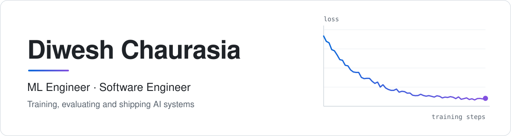

<picture>
  <source media="(prefers-color-scheme: dark)" srcset="assets/banner-dark.svg">
  
</picture>

## Hi, I'm Diwesh 👋

ML engineer who loves turning models into real, working software. I train them, test them properly, and build what it takes to ship them.

📍 Houston, TX · 🎓 MS in Computer Science (ML) at Rice University

<!-- 
  
 -->

<!-- 
  

 -->
<!-- - 🔭 I’m currently working on **A real time shopping website for Nepal** -->
<!-- - 🌱 I’m currently learning **Go, Rust, etc.** -->

<!-- - 💬 Ask me about **programming, DSA** -->

<!-- - 📫 How to reach me **diweshch2r@gmail.com** -->

<!-- - ⚡ Fun fact **Coffee is better than drugs** -->

### Featured work

| Project | What it does |
| --- | --- |
| [**signalfloor**](https://github.com/dch2r/signalfloor) | Tells you whether a drop in your LLM eval scores is a real regression or just noise. Shipped on PyPI with a CLI, GitHub Action, FastAPI server, Next.js dashboard and Helm chart. |
| [**VLM Hallucination Calibration**](https://github.com/dch2r/vlm-hallucination-calibration) | Training-free pipeline that finds and fixes hallucinated objects in Qwen2.5-VL captions using CLIP grounding. Cut caption-level hallucinations by 15.6% on MS COCO. |
| [**Chasing the Aha Moment**](https://github.com/dch2r/Chasing-the-Aha-Moment) | GRPO post-training of Qwen2.5-1.5B on a single T4, with an audit showing the score gain came from answer formatting rather than better math. Fully reproducible. |

<h3 align="left">What I work with</h3>

<table>
  <tr>
    <td><b>Languages</b></td>
    <td> Python, C++, TypeScript, SQL, Bash</td>
  </tr>
  <tr>
    <td><b>ML and LLMs</b></td>
    <td> Hugging Face Transformers, TRL, PEFT (LoRA), GRPO, CLIP, LangGraph, Ollama, RAG</td>
  </tr>
  <tr>
    <td><b>Backend and data</b></td>
    <td> FastAPI, SQLAlchemy, PostgreSQL, Next.js, NetworkX, Pandas</td>
  </tr>
  <tr>
    <td><b>Infra and MLOps</b></td>
    <td> Docker, Kubernetes, Helm, GitHub Actions, OpenTelemetry, AWS, Azure, Linux</td>
  </tr>
</table>

<!-- 

 -->

<!-- 
&nbsp;
 -->

